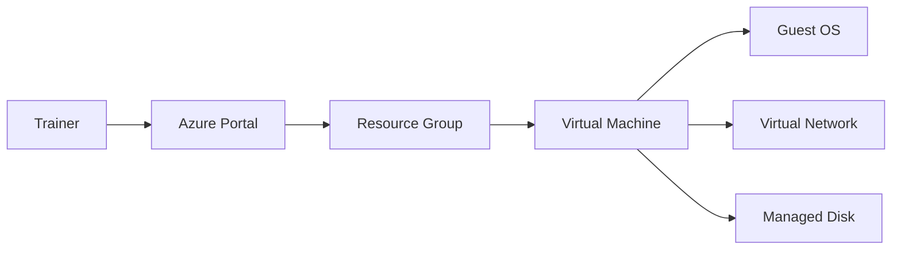

# Unofficial teach-back script — Azure Virtual Machines

**Illustrative rehearsal, ~8–10 minutes only.** Follow Microsoft's actual topic/slides/timing instead, if prescribed.

**Learning objective:** Beginners should explain what an Azure VM is, identify key deployment decisions and describe one security precaution.

## Sample talk track

**Introduction:** “If a company needs a server today, purchasing hardware may take time. An Azure virtual machine provides a software-defined server with configurable operating system, capacity, storage and networking. We'll learn which decisions matter.”

**Explain:** “Azure operates the physical hosts; customers manage the guest OS, installed software and many configuration decisions. Select an image, VM size and region that fit the workload. Plan identity, network controls and disks.”

**Demonstration outline:** In the Azure Portal, open **Virtual machines → Create → Azure virtual machine**, but do not deploy paid resources unnecessarily. Point out resource group, region, Linux/Windows image, size, authentication, inbound ports, disks and network. Explain why exposing SSH/RDP to the whole internet is risky and why least privilege matters.

**Check understanding:** “For a low-cost Linux workload with no publicly exposed management port, which four settings would you review first?” Expected: image/size, region, identity and networking.

**Wrap-up:** “We defined a VM, identified configuration choices and discussed keeping management access restricted.”

## Concept map

Keep cloud resources deleted if you create any for rehearsal, and avoid claiming the sample matches the official assessment.
